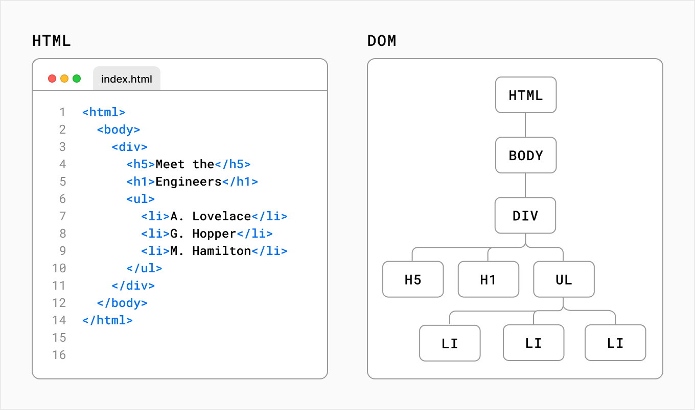

# Frontend libraries | with React

## The problem: keeping the UI in sync

- 2012, Facebook keeps re-shipping the same bug: the unread-messages badge says "1" but the inbox is empty ("zombie notification")
- One piece of state (the unread count), displayed in several places, mutated by hand from many code paths
- [Demo 1. A click counter in plain JavaScript](demo/demo-1): one variable, one DOM node, easy
- Now scale it: 50 components sharing state, every event handler must remember to update every affected DOM node
- This is the jQuery-era failure mode: the state of the application *is* the DOM, scattered and mutated everywhere
- Presented at [F8 2014](https://www.youtube.com/watch?v=nYkdrAPrdcw) as the motivation for React's architecture

## The big idea: UI = f(state)

- Stop mutating the DOM: *describe* what the UI looks like for a given state, re-render on every change
- Naively re-rendering the whole page is too slow, so React renders to a **virtual DOM** (a JavaScript tree), diffs it with the previous one, and patches the real DOM minimally



- The developer writes the *what*, React handles the *when* and *how*
- Since React 19, the [React Compiler](https://react.dev/learn/react-compiler) also optimizes re-renders at build time
- [Demo 2. The counter in React](demo/demo-2): the state is declared, React keeps the DOM in sync

## The vocabulary: components, JSX, props

React ([Meta, open source since 2013](https://react.dev/)) is a library: it does only the UI, the rest comes in the next modules. The minimum vocabulary to read React code:

### Components

- Independent and reusable pieces of UI, functions returning what to render, can be nested

```js
function Welcome({ name }) {
  return <h1>Hello, {name}</h1>
}

function App() {
  return <Welcome name="Sara" />
}
```

### JSX

- Ersatz HTML in JavaScript, transpiled (eg by [Babel](https://babeljs.io/)) into `React.createElement()` calls

```js
// What the JSX above becomes:
const element = React.createElement(Welcome, { name: 'Sara' })
```

- [Demo 3. The counter in JSX](demo/demo-3), transpiled live in the browser - compare with [demo 2](demo/demo-2) written directly with `createElement()`

### Props, and one-way data flow

- **Props** pass data from parent to child, read-only
- Data flows **down** (props), events flow **up** (callback props like `onClick`)
- This one-way flow is the lesson of the zombie notification: predictable, debuggable
- AngularJS bet on two-way binding (the view mutates the model directly), and lost

### Attaching to the DOM

```js
import { createRoot } from 'react-dom/client'
import App from './App'

createRoot(document.getElementById('root')).render(<App />)
```

## Where does state live?

- State is one of the hardest challenges in programming: memory, sessions, distributed systems and the [CAP theorem](https://en.wikipedia.org/wiki/CAP_theorem)
- Web applications historically deported it to the database (part of PHP-era Facebook's scalability), SPAs brought it back into the browser
- In React, the answer is a ladder: component → lifted to a parent → application-wide

### In one component: `useState`

- The [`useState` hook](https://react.dev/reference/react/useState) returns the current state and a setter, calling the setter triggers a re-render
- **Hooks**: functions to "hook into" React features (`useState`, `useEffect` for side effects, ...)

```js
import { useState } from 'react'

function Counter({ initialCount }) {
  const [count, setCount] = useState(initialCount)
  return (
    <button onClick={() => setCount(count + 1)}>
      You clicked {count} times
    </button>
  )
}
```

Prediction - one click on this button, what does it display?

```js
const handleClick = () => {
  setCount(count + 1)
  setCount(count + 1)
  setCount(count + 1)
}
```

- Answer: 1, not 3. `count` is a snapshot of the render: all three calls compute `0 + 1`. A classic bug in AI-generated code too

### Shared by siblings: lift it up

- Two components need the same state → move it to their closest common parent, pass it down as props
- Canonical example: a game `Board` owning the state of its `Square`s, as in the [official tutorial](https://react.dev/learn/tutorial-tic-tac-toe)

### Needed everywhere: Context

- Lifting everything to the root means **prop drilling**: every intermediate component relays props it doesn't use

```
<RootComponent>                  (user=...)        <RootComponent>                  (user=...)
  <IntermediateComponent>        (user=...)          <IntermediateComponent>            |
    <OtherIntermediateComponent> (user=...)   =>       <OtherIntermediateComponent>     |
      <ChildComponent>           (user=...)              <ChildComponent>           (user=...)
```

- The [Context API](https://react.dev/learn/passing-data-deeply-with-context) shares data at all levels: one provider, any number of consumers
- Simpler than the historic external stores (Redux, MobX) for most needs

Context initialization:

```jsx
import { createContext, useState } from 'react'

const Context = createContext()

export default Context

export const ContextProvider = ({ children }) => {
  const [user, setUser] = useState(null)
  return (
    <Context.Provider
      value={{
        user: user,
        login: (user) => { setUser(user) },
        logout: () => { setUser(null) }
      }}
    >
      {children}
    </Context.Provider>
  )
}
```

Provider registration, wrapping the application root:

```jsx
import { createRoot } from 'react-dom/client'
import { ContextProvider } from './Context'
import App from './App'

createRoot(document.getElementById('root')).render(
  <ContextProvider>
    <App />
  </ContextProvider>
)
```

Consumers, anywhere underneath:

```jsx
import { useContext } from 'react'
import Context from './Context'

export default () => {
  const { user, login, logout } = useContext(Context)
  return user
    ? <button onClick={() => logout()}>Logout {user}</button>
    : <button onClick={() => login('guest')}>Login</button>
}
```

## Why immutability?

- How does React know something changed? It compares **references**, not contents - deep-diffing every object on every render would be slower than re-rendering
- Mutate an object or array → same reference → React sees nothing

Prediction - what happens on click?

```js
const [items, setItems] = useState(['a', 'b'])
const addItem = () => {
  items.push('c')   // same array, same reference
  setItems(items)   // React: "nothing changed"
}
```

- Answer: nothing re-renders. Replace instead of mutating: `setItems([...items, 'c'])`
- Bonus: keeping old states intact gives history for free (undo, time travel)

## Forms: when the DOM has state too

- Form elements (`<input>`, `<textarea>`, `<select>`) maintain their own internal state: two sources of truth, pick one

### Native elements

- The DOM owns the state, read it on submission with the native `FormData` object (or a library like [react-hook-form](https://react-hook-form.com/))
- Enough for a simple "fill and submit" form

```jsx
const MyForm = function() {
  const onSubmit = function(e) {
    e.preventDefault()
    const data = new FormData(e.target)
    console.log(data)
  }
  return (
    <form onSubmit={onSubmit}>
      <input type="text" name="my_input" />
      <button>Submit</button>
    </form>
  )
}
```

### Controlled elements

- React owns the state, the element value is driven by it: the "single source of truth"
- Needed for live validation, dependent fields, instant feedback

```jsx
import { useState } from 'react'

const MyForm = function() {
  const [data, setData] = useState({})
  const onSubmit = function(e) {
    e.preventDefault()
    console.log(data)
  }
  return (
    <form onSubmit={onSubmit}>
      <input
        type="text"
        name="my_input"
        value={data.my_input ?? ''}
        onChange={e => setData({ ...data, my_input: e.target.value })}
      />
      <button>Submit</button>
    </form>
  )
}
```

## The landscape in 2026

### A short history

- **1995-2005**: static pages, forms, full page reloads, JavaScript sprinkles some interactivity
- **jQuery** (2006): simplified DOM manipulation, hid browser incompatibilities, still everywhere
- **AngularJS** (2010, Google), **Backbone** (2010): structure for growing single-page applications
- **React** (2013, Facebook): declarative UI with components and a virtual DOM
- **Vue.js** (2014): progressive approach, inspired by both
- **Svelte** (2016), **Solid** (2021): compile-time work, reactivity based on signals

Components won, and React won the components era: top of the [State of JS surveys](https://stateofjs.com/), [npm downloads](https://npmtrends.com/react-vs-solid-js-vs-svelte-vs-vue) and frontend job offers for a decade.

### Newer ideas, and who follows

- **Signals** (Solid, Preact): fine-grained reactivity, update only the DOM nodes observing a value, no re-render, no virtual DOM. The historic players followed: Vue refs, Angular signals, Svelte 5 runes, and a [TC39 proposal](https://github.com/tc39/proposal-signals) to put them in JavaScript itself. React did not: it keeps its re-render model and bets on the compiler to make it cheap
- **Compilation over runtime** (Svelte): do the work at build time, ship less JavaScript. React partially followed with the React Compiler
- **Less JavaScript at all** (Qwik's resumability, Astro's islands): the cost isn't rendering, it's shipping and hydrating JS. React's answer is Server Components - module 6
- **Back to hypermedia** ([htmx](https://htmx.org/)): HTML over the wire, barely any JS, the server renders everything - jQuery-era simplicity, deliberately
- **Web Components**: the browser-native component standard, usable from any library, properly supported by React since v19. Standardization is slow, adoption modest

Takeaway: the *ideas* (components, declarative UI, state ownership) transfer across all of them. React rarely invents first, but absorbs what wins.

### React in the age of AI

AI changed who types the code, not what runs in the browser:

- AI assistants (Copilot, Claude, Cursor) and UI generators (v0, Lovable, Bolt) output React by default
- Chat assistants render their interactive answers (Claude artifacts, ChatGPT canvas) as React components
- Most represented UI library in LLM training data: the dominance is self-reinforcing
- Less boilerplate written, much more reviewed: reading React fluently is the new literacy
- AI-generated React fails in predictable ways: state mutations, stale snapshots, overused `useEffect`, missing list keys - two of them appeared in the predictions above
- [Live experiment](demo/README.md#bonus-live-experiment): ask an AI for a click counter, see what it picks

---

*The content of this document, including all text, images, and associated materials, is the exclusive property of Adaltas and is protected by applicable copyright laws. Unauthorized distribution, reproduction, or sharing of this content, in whole or in part, is strictly prohibited without the express written consent of the author(s). Any violation of this restriction may result in legal action and the imposition of penalties as prescribed by law.*
