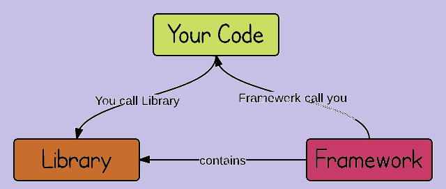

# Web frameworks | with Next.js

## The problem: a library is not an application

- A standalone React application (module 4): one page, one component tree, a dev server - React is enough
- A real website asks questions React doesn't answer:
  - **Routing** - several pages, URLs, navigation between them
  - **Data fetching** - where the data lives, how to get it
  - **Rendering** - static or dynamic, on the server or in the browser, SEO (module 6)
  - **Performance** - code splitting, prefetching, caching
  - **Infrastructure** - building, deploying, serving
- All of it can be assembled by hand: a router, a bundler config, server-side rendering... every team rebuilding the same plumbing, and maintaining it

## Library vs Framework

- **Libraries** are building blocks that can be used anywhere (like bricks)
- **Frameworks** dictate how the project is structured (like frames)
- The code calls a library, a framework calls the code (**inversion of control**)
- React renders components, a framework runs the application



## Why (not) a framework

For:

- Reuse essential building blocks, focus on business logic
- Common guidelines based on best practices: a Next.js developer is productive in any Next.js project

Against:

- Frameworks start lean before becoming complex monsters
- Hard to extend and customize, constraining conventions (inversion of control cuts both ways)
- Frameworks come and go, implying maintenance burden and technical debt
- See [Using a Framework will harm the maintenance of your software](https://berk.es/2022/09/06/frameworks-harm-maintenance/) - ([HN](https://news.ycombinator.com/item?id=33185010))

## The React meta-frameworks

The React team itself [recommends starting with a framework](https://react.dev/learn/creating-a-react-app):

- [Next.js](https://nextjs.org/) (Vercel): the most popular, full-stack, the choice of this course
- [React Router](https://reactrouter.com/) (merged with Remix): the historic router, grown into a framework
- [TanStack Start](https://tanstack.com/start/): the newcomer, client-first
- [Gatsby](https://www.gatsbyjs.com/): historic static-site generator, declining
- Every ecosystem grew its own: Nuxt (Vue), SvelteKit (Svelte), Analog (Angular)
- Same self-reinforcing dominance as React: AI scaffolders (v0, Lovable, Bolt) output Next.js by default

## Next.js: what it brings

- **File-based routing**: the URL structure is the folder structure, no router configuration
- **Layouts**: shared UI that persists across navigation
- **Rendering freedom**: static, server or client rendering, chosen per route (module 6)
- **Server Components** by default: less JavaScript shipped to the browser
- Automatic code splitting, prefetching, image and font optimization
- API endpoints ([Route Handlers](https://nextjs.org/docs/app/api-reference/file-conventions/route)) in the same project
- The price: strong conventions (file names have meaning), and the architecture follows Vercel's roadmap

## Thinking in pages and layouts

The mental model: a route is a folder path, special file names give it behavior.

```
app/
  layout.js           -> wraps every page: header, footer, nav
  page.js             -> /
  about/page.js       -> /about
  articles/
    page.js           -> /articles
    [slug]/page.js    -> /articles/my-first-post (dynamic segment)
  not-found.js        -> 404
```

- A **page** is what's unique to a route, a **layout** is what persists around it - on navigation, the layout does not re-render, only the page changes
- A **dynamic segment** (`[slug]`) serves the content unknown in advance
- Components stay what they were in module 4: pages and layouts are just components, assembled from custom ones (`Header`, `Footer`, `Nav`, ...)
- Design before coding: list the routes, mark them static or dynamic

---

*The content of this document, including all text, images, and associated materials, is the exclusive property of Adaltas and is protected by applicable copyright laws. Unauthorized distribution, reproduction, or sharing of this content, in whole or in part, is strictly prohibited without the express written consent of the author(s). Any violation of this restriction may result in legal action and the imposition of penalties as prescribed by law.*
